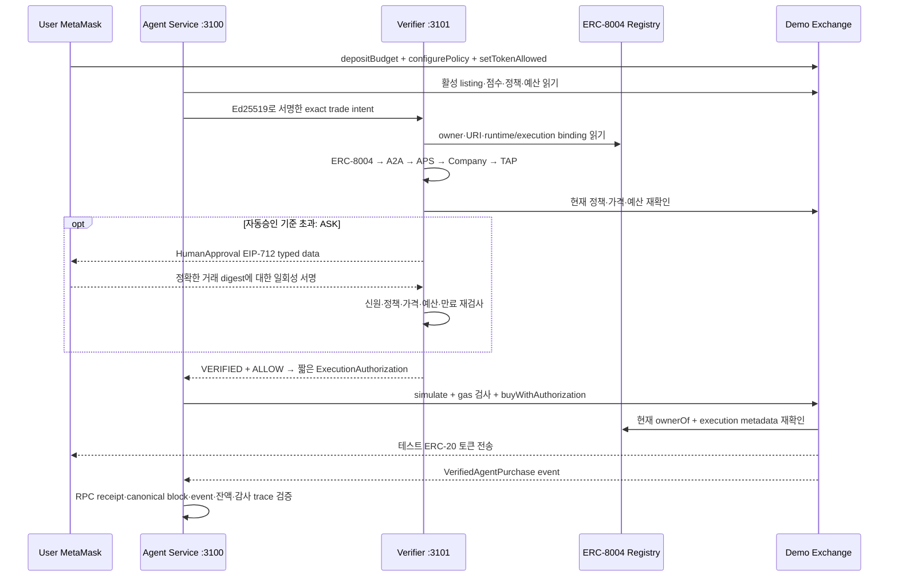

# Sepolia verified-agent trading architecture

AgentProof의 거래 경로는 **Authentication → Authorization → Execution**을 각각 독립적으로 검사한다. 신원 인증 성공만으로 사용자 자금을 사용할 수 없다. 기존 KRW `mock-purchase` 데모와 새로운 `agentproof-trade-v1` 요청은 서로 다른 schema·ticket operation을 사용한다.

## 역할과 데이터 경계

| 역할 | 하는 일 | 서명 및 자금 |
|---|---|---|
| Merchant MetaMask | Exchange·DemoToken 배포, listing·관리 기능 | Merchant가 직접 승인하며 서버에 키를 제공하지 않음 |
| User MetaMask | 예산 예치·출금, 정책·허용 토큰 설정, 필요 시 추가 승인 | 구매 토큰 수령 지갑. Agent에게 사용자 개인키를 제공하지 않음 |
| Agent Ed25519 runtime identity | Agent Card·Passport·TAP-compatible 요청 증명 | 기존 ERC-8004 runtime binding과 연결된 키 |
| Agent EVM execution wallet | 승인된 `buyWithAuthorization` transaction 제출 | 별도 secp256k1 테스트 키. gas만 필요하며 사용자 예산은 Exchange에 있음 |
| Verifier EVM attestation key | `VERIFIED + ALLOW`인 정확한 행동만 EIP-712 서명 | 자금을 보관하지 않는 별도 secp256k1 키 |
| Exchange contract | 예산 보관, 정책·인증서명·nonce·현재 owner/metadata 집행 | 고정 기능의 테스트 토큰 구매만 지원 |

## 온체인과 오프체인 증거

| 정보 | UI 라벨 | 저장·검증 위치 |
|---|---|---|
| ERC-8004 owner·agentURI·runtime metadata·execution metadata | `ON-CHAIN` | 공식 Sepolia IdentityRegistry |
| token·listing·price·demoScore·inventory | `ON-CHAIN` | DemoToken 및 Exchange. demoScore의 의미 자체는 합성 데이터 |
| deposit·policy·allowed tokens·spent·used nonce·purchase event | `ON-CHAIN` | Exchange |
| A2A Agent Card, APS Passport, TAP-compatible trade request | `OFF-CHAIN SIGNED` | 공개 문서 또는 서명된 HTTP payload |
| Company 테스트 확인자료 | `LOCAL DEMO ATTESTATION` | 로컬 개발용 issuer. 실제 기업 KYC가 아님 |
| verifier 판단 근거·상세 audit | 오프체인 evidence | 역할별 로컬 DB·파일. evidence hash와 trace reference만 event에 연결 |
| 기존 registry simulator 및 Anvil용 신원 fixture | `SIMULATION` | 개발 테스트. 공식 Sepolia registry와 구분 |

모든 정보가 온체인인 시스템이 아니다. 온체인 구매 기록은 인증 과정에서 참조한 문서 원문이나 기업의 실재성까지 독립적으로 보증하지 않는다.

## 네이티브 Node 구조

기존 Node.js 22 TypeScript stripping·정적 HTML/CSS/JS 구조를 유지한다. `integrations`의 고정 버전 `viem`을 재사용한다. 금융 금액 및 token 최소 단위 수량은 `bigint` 또는 canonical decimal string이며 ETH 계산에 부동소수점을 사용하지 않는다.

| 구성 | 기본 URL / 파일 |
|---|---|
| 기존 Sepolia Identity Console | `http://127.0.0.1:3100/` |
| Trading Demo | `http://127.0.0.1:3100/trading` |
| Verifier Dashboard | `http://127.0.0.1:3101/` |
| Merchant Exchange Portal | `http://127.0.0.1:3200/` |
| Agent orchestration | `packages/trading/backend.ts` |
| Verifier spending boundary | `services/verifier-service/trading.ts` |
| pinned-block chain reads and prepared MetaMask writes | `services/common/trading-chain.ts` |
| schemas, policy, signing, receipt and audit helpers | `packages/trading/`, `packages/authorization/` |

자연어는 명시적으로 지원하는 `BUY_HIGHEST_DEMO_SCORE_TOKEN` 시나리오만 해석한다. 활성화된 허용 token 중 최고 점수를 선택하고, 같은 점수는 주소 순서로 결정한다. 정책 잔여 예산·예치액·1회 한도·inventory 안에서 수량을 계산한다. 점수는 실제 수익 예측이 아니며 다음 문구를 UI에 표시한다.

> 이 점수는 시스템 흐름 검증을 위한 합성 데모 데이터이며 실제 투자 전망이나 금융 조언이 아닙니다.

## 신원과 execution binding

기존 Agent ID 및 root `agentURI`를 유지한다. `agentproof.runtimeBinding.v1`을 교체하지 않고 `agentproof.executionWallet.v1`에 `abi.encode(address)` 32 bytes를 저장한다. 변경은 현재 ERC-8004 owner가 MetaMask로 승인한다. 별도 Agent Card execution-wallet extension에도 같은 주소·chain·registry·agent ID를 포함하고 Ed25519로 card 전체를 다시 서명한다. 새 공개 card는 기존 HTTPS URL에 게시해야 한다.

공통 테스트 벡터는 주소 `0x1234567890123456789012345678901234567890` → `0x0000000000000000000000001234567890123456789012345678901234567890`이다. Solidity와 Node가 같은 인코딩을 검사한다.

## 제출과 실패 처리

Agent는 verifier 서명 검증, 현재 owner·execution binding 확인, contract simulation, gas estimate와 balance 확인 뒤에만 transaction을 준비한다. gas 부족은 `AGENT_EXECUTOR_GAS_INSUFFICIENT`로 종료한다. 서명한 transaction hash를 방송 전에 저장하여 중복 클릭·재시작으로 같은 작업을 다시 제출하지 않게 한다.

서버는 브라우저가 제출한 receipt를 신뢰하지 않는다. RPC에서 transaction·receipt·block을 다시 읽고 chain, sender, target, calldata, value, block hash, 구매 event와 수량을 검사한다. 사용자의 token balance 증가까지 확인해야 `CONFIRMED`이다. 방송 후 RPC 연결이 끊기면 이미 거래가 발생했을 가능성이 있으므로 실패를 단정하거나 자동 재전송하지 않고 저장된 hash로 reconcile한다.

각 거래의 intent, Authentication 모듈 결과, Authorization, human approval, execution authorization, transaction, receipt와 balance 변경을 같은 거래 trace로 연결한다. 인증 trace와 거래 trace는 서로 참조하며 event에는 bytes32 trace reference가 들어간다. 원문 private key, 인증표, 관리자 token, raw signature는 공개 trace에 포함하지 않는다.

TAP은 AgentProof의 제한형 HTTP signature profile이며 Visa 인증 구현이 아니다. x402는 유료 HTTP resource 결제 프로토콜이므로 이 Exchange contract 매매 경로에 넣지 않는다. 향후 유료 API 구매가 필요하면 별도 adapter를 설계한다.

표준 근거: [ERC-8004 Identity Registry metadata](https://eips.ethereum.org/EIPS/eip-8004), [OpenZeppelin EIP-712](https://docs.openzeppelin.com/contracts/5.x/api/utils/cryptography). execution-wallet metadata key와 trading authorization은 AgentProof의 별도 프로파일이며 ERC-8004 자체가 거래 권한을 제공한다는 뜻이 아닙니다.
